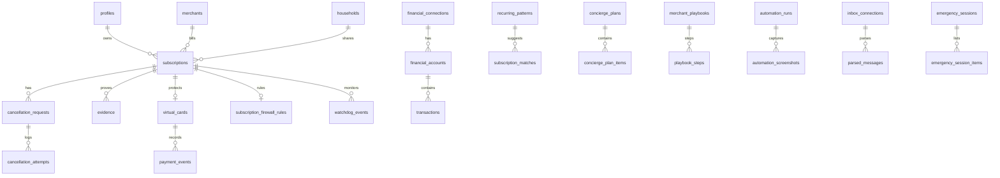

# Subscription Guard — Complete App Build-Out

Single reference for the **full product**: features, routes, database schema,
storage, jobs, and integrations. Everything below is the target build — not a
phased rollout map.

**Safety rules (always on):**
- Cancellation requires explicit user approval before any merchant contact.
- `payment_blocked` and `cancellation_confirmed` are never the same state.
- `subscriptions.status` is the only source of truth for current subscription state.

**Stack:** Next.js App Router · Supabase Auth/Postgres/Storage · Vercel · Plaid ·
Resend · Card issuer (Stripe Issuing / Lithic / Marqeta) · optional inbox OAuth.

---

## Product capabilities (complete)

### Identity & account
- Magic Link sign-in (email only)
- User profile (display name, timezone)
- Account settings, JSON data export
- Account deletion with cascade purge
- Privacy preferences and data purge requests

### Subscription tracking
- Manual subscription create, edit, archive, delete
- Merchant directory (name, website, cancellation URL, support email)
- Billing amount, currency, interval (weekly / monthly / quarterly / annual)
- Trial start/end, next renewal, cancellation deadline
- Annualized cost on dashboard
- Dashboard summary: monthly spend, annual spend, renewals in 7 days, needs-attention badges
- Filter: all subscriptions vs needs attention (trial ending, renewal soon, failed cancel, post-cancel charge)

### Renewal reminders
- Auto-schedule notifications at 7 days, 3 days, 24 hours before renewal
- Per-subscription mute and snooze
- Hourly cron sends email via Resend (or logs stub when provider not configured)

### Cancellation (human-in-the-loop)
- Cancellation message draft (merchant, plan, account email)
- User clicks **Approve and prepare** before anything is recorded
- Copy to clipboard; user sends email themselves
- Optional “mark as sent via email” → append-only attempt log
- Status updates: cancellation requested → submitted → confirmed / failed
- Failed path shows retry; never silently drops
- Chronological timeline: requests, attempts, evidence
- Flag **payment detected after cancel** (distinct from merchant confirmed)

### Evidence & audit
- Private evidence upload (screenshots, PDFs) per subscription
- Storage path: `{user_id}/{subscription_id}/{evidence_id}.ext`
- Signed URLs for download
- Immutable audit log for all significant actions

### Bank & card monitoring
- Connect financial institutions (Plaid)
- Linked accounts with masks and types
- Historical + incremental transaction import
- Webhook-driven sync
- Recurring-charge detection with confidence score
- Review queue: user must accept or reject each suggested match — never auto-create subscription from a transaction
- Price-change alerts when recurring amount shifts
- CSV import fallback
- Disconnect institution and delete imported financial data
- Post-cancellation transaction detection cross-referenced with subscriptions

### Virtual payment protection (Cloaked-style, per subscription)
- One virtual card per protected subscription (not per arbitrary purchase)
- Merchant restriction, max charge amount, max payment count
- Manual or scheduled freeze before renewal
- Real-time authorization webhooks (approve / decline)
- Payment events log with idempotent provider event IDs
- Daily reconciliation job matching payments to subscriptions
- Subscription state **payment_blocked** when card frozen/declined — never labeled canceled
- Competitive positioning: subscription-scoped privacy + renewal control vs general wallet-per-purchase products

### Browser extension & cancellation assist
- Trial signup detection with **explicit confirm panel** before saving
- Extension reads and suggests — never auto-fills or auto-submits forms
- Merchant-specific cancellation playbooks (steps, difficulty score)
- Sandboxed automation workers (e.g. Playwright) with screenshot trail
- Mandatory user approval before final submit on every run
- Stop and ask user when cancel action cannot be identified confidently

### AI concierge & savings
- Natural-language commands → reviewable action plan (cancel X, keep Y) — nothing executes without approval
- Usage-based idle subscription detection (opt-in connections only)
- Monthly savings / health report: spend totals, duplicates, price increases, recommendations
- Bill negotiation and refund **drafts** only — user copies/sends; no autonomous disputes

### Subscription firewall
- Per-subscription rules: max charge, payment count, renewal approval required, auto-freeze window, auto-expire
- Tied to virtual card controls

### Post-cancellation watchdog
- Descriptor-change detection
- “Final invoice” charge detection
- Reinstated-subscription detection
- Formal **cancellation_verified** status when watchdog criteria met

### Household mode
- Shared household workspace
- Shared subscription visibility with individual ownership
- “Who uses this” labels
- Household spending limits
- Private financial accounts per member (RLS across members)

### Inbox & receipt intelligence
- Forward-to address or limited OAuth inbox connection
- Parse trial-end and renewal language from emails/receipts
- User confirms before creating/updating subscriptions
- No silent full-mailbox scraping

### Cancellation passport
- Exportable PDF packet per subscription: merchant, billing history, cancel URL, requests, confirmations, evidence timeline

### Emergency financial mode
- One action: list all recurring charges, freeze protected cards, queue cancellation review list
- Every freeze/cancel item still requires individual user confirmation

### Merchant intelligence (anonymized network)
- Aggregated stats: cancel difficulty, refund behavior, response time, contact method, virtual-card acceptance, billing descriptors, parent companies

### Legal & compliance surface
- Privacy policy and terms pages
- No storage of raw PAN, CVV, or bank passwords
- Provider tokens encrypted server-side only
- RLS on every user-owned table

---

## App routes (complete)

| Route | Purpose |
|-------|---------|
| `/` | Landing |
| `/login` | Magic Link request |
| `/auth/callback` | OAuth-style code exchange |
| `/privacy` | Privacy policy |
| `/terms` | Terms of service |
| `/dashboard` | Summary cards, subscription list, filters |
| `/dashboard/subscriptions/new` | Add subscription |
| `/dashboard/subscriptions/[id]` | Edit, evidence, timeline, reminders, firewall |
| `/dashboard/subscriptions/[id]/cancel` | Cancellation workflow |
| `/dashboard/financial` | Connected accounts, transactions, match queue |
| `/dashboard/financial/import` | CSV import |
| `/dashboard/cards` | Virtual cards per subscription |
| `/dashboard/concierge` | AI action plans |
| `/dashboard/savings` | Monthly health reports |
| `/dashboard/household` | Household members and shared subs |
| `/dashboard/inbox` | Inbox connection and parsed messages |
| `/dashboard/emergency` | Emergency spending pause flow |
| `/dashboard/settings` | Export, delete account, privacy prefs |
| `/api/cron/send-reminders` | Hourly renewal notifications |
| `/api/cron/reconcile-payments` | Daily payment reconciliation |
| `/api/webhooks/plaid` | Transaction sync |
| `/api/webhooks/issuer` | Card authorization events |

---

## Database schema (complete)

### Auth & profile

**`auth.users`** — Supabase managed  

**`profiles`**
| Column | Type | Notes |
|--------|------|-------|
| id | uuid PK | FK → auth.users |
| email | text | |
| display_name | text | |
| timezone | text | default America/New_York |
| created_at | timestamptz | |
| updated_at | timestamptz | |

**`privacy_preferences`**
| Column | Type |
|--------|------|
| user_id | uuid PK FK |
| auto_delete_evidence_after_days | integer nullable |
| allow_product_analytics | boolean |
| allow_anonymized_merchant_stats | boolean |
| updated_at | timestamptz |

**`data_purge_requests`**
| Column | Type |
|--------|------|
| id | uuid PK |
| user_id | uuid FK |
| scope | text (financial, inbox, evidence, all) |
| status | pending, completed, failed |
| requested_at | timestamptz |
| completed_at | timestamptz |

---

### Merchants & intelligence

**`merchants`** — shared reference
| Column | Type |
|--------|------|
| id | uuid PK |
| name | text NOT NULL |
| normalized_name | text |
| website_url | text |
| cancellation_url | text |
| support_email | text |
| parent_company | text |
| created_at | timestamptz |

**`merchant_intelligence_stats`** — anonymized aggregates, no user_id
| Column | Type |
|--------|------|
| merchant_id | uuid PK FK |
| cancel_difficulty_score | numeric |
| avg_refund_days | numeric |
| avg_cancel_minutes | integer |
| accepts_virtual_card | boolean |
| preferred_cancel_method | text |
| common_billing_descriptors | text[] |
| sample_size | integer |
| updated_at | timestamptz |

**`merchant_playbooks`**
| Column | Type |
|--------|------|
| id | uuid PK |
| merchant_id | uuid FK |
| difficulty_score | numeric |
| preferred_method | text |
| source | crowdsourced, editorial |
| version | integer |
| updated_at | timestamptz |

**`playbook_steps`**
| Column | Type |
|--------|------|
| id | uuid PK |
| playbook_id | uuid FK |
| step_order | integer |
| instruction | text |
| selector_hint | text |

---

### Subscriptions (source of truth)

**`subscriptions`**
| Column | Type | Notes |
|--------|------|-------|
| id | uuid PK | |
| user_id | uuid FK | owner |
| merchant_id | uuid FK | |
| household_id | uuid FK nullable | shared visibility |
| name | text NOT NULL | |
| status | text | see status enum |
| billing_amount | numeric | |
| currency | text | default USD |
| billing_interval | text | weekly, monthly, quarterly, annual |
| trial_start_at | timestamptz | |
| trial_end_at | timestamptz | |
| next_renewal_at | timestamptz | |
| cancellation_deadline_at | timestamptz | |
| source | text | manual, bank_match, inbox, extension |
| notes | text | |
| who_uses_label | text | household label |
| reminders_muted | boolean | default false |
| reminders_snoozed_until | timestamptz | |
| created_at | timestamptz | |
| updated_at | timestamptz | |

**Subscription status values**

| status | Meaning |
|--------|---------|
| trial | Active trial window |
| active | Recurring, no cancel in progress |
| renewal_approaching | Renewal soon (badge/filter) |
| cancellation_requested | User approved cancel preparation |
| cancellation_submitted | User reported sent to merchant |
| cancellation_confirmed | Merchant confirmed cancellation |
| cancellation_failed | Attempt failed; retry available |
| payment_detected_after_cancel | Charge after cancel — not canceled |
| payment_blocked | Virtual card frozen/declined — not canceled |
| cancellation_verified | Watchdog confirmed clean post-cancel |
| archived | User archived |

---

### Cancellation workflow

**`cancellation_requests`**
| Column | Type |
|--------|------|
| id | uuid PK |
| subscription_id | uuid FK |
| user_id | uuid FK |
| status | draft, awaiting_approval, approved, in_progress, completed, failed, needs_manual_action |
| method | text |
| user_approved_at | timestamptz |
| requested_at | timestamptz |
| completed_at | timestamptz |
| failure_reason | text |
| created_at, updated_at | timestamptz |

**`cancellation_attempts`** — append-only
| Column | Type |
|--------|------|
| id | uuid PK |
| cancellation_request_id | uuid FK |
| method | text |
| message_body | text |
| target_url | text |
| result | prepared, sent, confirmed, rejected, no_response, failed |
| response_notes | text |
| attempted_at | timestamptz |

**`negotiation_drafts`** — refund/rate/dispute drafts; never auto-send
| Column | Type |
|--------|------|
| id | uuid PK |
| user_id | uuid FK |
| subscription_id | uuid FK |
| draft_type | refund, rate_reduction, duplicate_charge |
| body_text | text |
| evidence_ids | uuid[] |
| status | draft, copied_by_user, discarded |
| created_at | timestamptz |

---

### Evidence & audit

**`evidence`**
| Column | Type |
|--------|------|
| id | uuid PK |
| user_id | uuid FK |
| subscription_id | uuid FK |
| evidence_type | screenshot, email, receipt, … |
| storage_path | text |
| description | text |
| created_at | timestamptz |

**`audit_events`** — immutable
| Column | Type |
|--------|------|
| id | uuid PK |
| user_id | uuid FK |
| action | text |
| entity_type | text |
| entity_id | uuid |
| metadata | jsonb |
| created_at | timestamptz |

---

### Notifications & reminders

**`notifications`**
| Column | Type |
|--------|------|
| id | uuid PK |
| user_id | uuid FK |
| subscription_id | uuid FK |
| notification_type | renewal_7_days, renewal_3_days, renewal_24_hours, renewal_detected, payment_after_cancellation, price_change |
| scheduled_for | timestamptz |
| sent_at | timestamptz |
| status | scheduled, sent, stub_logged, skipped |
| created_at | timestamptz |

---

### Financial monitoring

**`financial_connections`**
| Column | Type |
|--------|------|
| id | uuid PK |
| user_id | uuid FK |
| provider | text |
| provider_item_id | text |
| encrypted_access_token | text |
| institution_name | text |
| status | active, disconnected, error |
| last_synced_at | timestamptz |
| created_at, updated_at | timestamptz |

**`financial_accounts`**
| Column | Type |
|--------|------|
| id | uuid PK |
| user_id | uuid FK |
| connection_id | uuid FK |
| provider_account_id | text |
| account_name, account_type, account_mask | text |
| currency | text |
| is_active | boolean |
| created_at | timestamptz |

**`transactions`**
| Column | Type |
|--------|------|
| id | uuid PK |
| user_id | uuid FK |
| financial_account_id | uuid FK |
| provider_transaction_id | text UNIQUE per account |
| merchant_name_raw, merchant_name_normalized | text |
| amount | numeric |
| currency | text |
| transaction_date | date |
| pending | boolean |
| category | text |
| raw_data_hash | text |
| created_at, updated_at | timestamptz |

**`recurring_patterns`**
| Column | Type |
|--------|------|
| id | uuid PK |
| user_id | uuid FK |
| merchant_name | text |
| frequency | text |
| average_amount | numeric |
| last_charge_at, predicted_next_charge_at | timestamptz |
| confidence_score | numeric |
| status | pending_review, confirmed, dismissed |
| created_at, updated_at | timestamptz |

**`subscription_matches`**
| Column | Type |
|--------|------|
| id | uuid PK |
| recurring_pattern_id | uuid FK |
| subscription_id | uuid FK nullable |
| confidence_score | numeric |
| match_status | suggested, accepted, rejected |
| confirmed_at | timestamptz |

**`price_change_alerts`**
| Column | Type |
|--------|------|
| id | uuid PK |
| user_id | uuid FK |
| subscription_id | uuid FK |
| previous_amount, new_amount | numeric |
| transaction_id | uuid FK nullable |
| detected_at | timestamptz |
| acknowledged_at | timestamptz |

**`import_batches`** — CSV fallback
| Column | Type |
|--------|------|
| id | uuid PK |
| user_id | uuid FK |
| filename | text |
| row_count | integer |
| status | processing, completed, failed |
| created_at | timestamptz |

---

### Virtual cards & payments

**`virtual_cards`**
| Column | Type |
|--------|------|
| id | uuid PK |
| user_id | uuid FK |
| subscription_id | uuid FK UNIQUE |
| issuer_provider | text |
| issuer_card_id | text |
| status | pending_issuance, active, frozen, closed |
| merchant_restriction | text |
| max_charge_amount | numeric |
| max_payments | integer |
| frozen_at | timestamptz |
| created_at, updated_at | timestamptz |

**`payment_events`**
| Column | Type |
|--------|------|
| id | uuid PK |
| user_id | uuid FK |
| subscription_id | uuid FK |
| virtual_card_id | uuid FK |
| provider_event_id | text UNIQUE |
| amount | numeric |
| currency | text |
| decision | approved, declined |
| merchant_descriptor | text |
| occurred_at | timestamptz |
| created_at | timestamptz |

**`subscription_firewall_rules`**
| Column | Type |
|--------|------|
| id | uuid PK |
| subscription_id | uuid FK UNIQUE |
| virtual_card_id | uuid FK |
| max_charge | numeric |
| max_payments_per_period | integer |
| require_renewal_approval | boolean |
| auto_freeze_before_renewal_hours | integer |
| auto_expire_at | timestamptz |
| updated_at | timestamptz |

---

### Watchdog

**`watchdog_events`**
| Column | Type |
|--------|------|
| id | uuid PK |
| user_id | uuid FK |
| subscription_id | uuid FK |
| event_type | descriptor_change, final_invoice, reinstated, no_charge_30d |
| transaction_id | uuid FK nullable |
| detected_at | timestamptz |
| resolved_at | timestamptz |

---

### Browser extension & automation

**`browser_capture_sessions`**
| Column | Type |
|--------|------|
| id | uuid PK |
| user_id | uuid FK |
| status | pending_user_confirm, confirmed, discarded |
| detected_merchant_name | text |
| detected_trial_end | timestamptz |
| detected_price | numeric |
| cancellation_url | text |
| raw_payload | jsonb |
| confirmed_at | timestamptz |
| subscription_id | uuid FK nullable |

**`automation_runs`**
| Column | Type |
|--------|------|
| id | uuid PK |
| user_id | uuid FK |
| cancellation_request_id | uuid FK |
| playbook_id | uuid FK |
| status | running, paused_for_approval, completed, failed |
| user_approved_final_submit_at | timestamptz |
| started_at, finished_at | timestamptz |

**`automation_screenshots`**
| Column | Type |
|--------|------|
| id | uuid PK |
| run_id | uuid FK |
| storage_path | text |
| captured_at | timestamptz |

---

### AI concierge & savings

**`concierge_plans`**
| Column | Type |
|--------|------|
| id | uuid PK |
| user_id | uuid FK |
| prompt_text | text |
| status | draft, awaiting_approval, approved, executed, dismissed |
| user_approved_at | timestamptz |
| created_at | timestamptz |

**`concierge_plan_items`**
| Column | Type |
|--------|------|
| id | uuid PK |
| plan_id | uuid FK |
| subscription_id | uuid FK |
| action_type | cancel, archive, freeze_card, mute_reminders, … |
| executed_at | timestamptz |

**`usage_connections`** — opt-in
| Column | Type |
|--------|------|
| id | uuid PK |
| user_id | uuid FK |
| provider | text |
| scopes | text[] |
| revoked_at | timestamptz |

**`usage_signals`**
| Column | Type |
|--------|------|
| id | uuid PK |
| user_id | uuid FK |
| subscription_id | uuid FK |
| signal_type | text |
| last_seen_at | timestamptz |
| metadata | jsonb |

**`savings_reports`**
| Column | Type |
|--------|------|
| id | uuid PK |
| user_id | uuid FK |
| period_start, period_end | date |
| total_recurring_spend | numeric |
| duplicate_services | jsonb |
| price_increases | jsonb |
| recommendations | jsonb |
| generated_at | timestamptz |

---

### Household

**`households`**
| Column | Type |
|--------|------|
| id | uuid PK |
| name | text |
| owner_user_id | uuid FK |
| spending_limit_monthly | numeric nullable |
| created_at | timestamptz |

**`household_members`**
| Column | Type |
|--------|------|
| household_id | uuid FK |
| user_id | uuid FK |
| role | owner, member |
| invited_at, accepted_at | timestamptz |
| PK | (household_id, user_id) |

**`household_subscriptions`**
| Column | Type |
|--------|------|
| household_id | uuid FK |
| subscription_id | uuid FK |
| owner_user_id | uuid FK |
| label_who_uses | text |

---

### Inbox intelligence

**`inbox_connections`**
| Column | Type |
|--------|------|
| id | uuid PK |
| user_id | uuid FK |
| provider | text |
| encrypted_token | text |
| forward_address | text |
| scopes | text[] |
| revoked_at | timestamptz |

**`parsed_messages`**
| Column | Type |
|--------|------|
| id | uuid PK |
| connection_id | uuid FK |
| message_hash | text UNIQUE |
| subject, snippet | text |
| trial_end_detected | timestamptz |
| subscription_id | uuid FK nullable |
| user_confirmed_at | timestamptz |
| received_at | timestamptz |

---

### Emergency mode

**`emergency_sessions`**
| Column | Type |
|--------|------|
| id | uuid PK |
| user_id | uuid FK |
| status | active, completed, cancelled |
| started_at, ended_at | timestamptz |

**`emergency_session_items`**
| Column | Type |
|--------|------|
| id | uuid PK |
| session_id | uuid FK |
| subscription_id | uuid FK |
| action | freeze_card, queue_cancel_review |
| user_confirmed_at | timestamptz |

---

## Storage buckets

| Bucket | Access | Purpose |
|--------|--------|---------|
| evidence | private, `{user_id}/…` | Cancel confirmations, receipts |
| automation | private, `{user_id}/…` | Automation run screenshots |

---

## Background jobs

| Job | Schedule | Function |
|-----|----------|----------|
| send-reminders | hourly | Due renewal notifications → email |
| reconcile-payments | daily | Match payment_events to subscriptions |
| sync-transactions | webhook + hourly | Plaid incremental sync |
| generate-savings-report | monthly | Build savings_reports per user |
| watchdog-scan | daily | Descriptor/reinstatement checks |

---

## External integrations

| Integration | Purpose |
|-------------|---------|
| Supabase Auth | Magic Link |
| Supabase Postgres + RLS | All app data |
| Supabase Storage | Evidence, automation screenshots |
| Resend | Transactional email |
| Plaid | Bank/card transactions |
| Card issuer API | Virtual cards + auth webhooks |
| Inbox OAuth / forward-to | Receipt and trial email parsing |

---

## Entity relationship (full)

---

## Implementation note

Executable SQL for the core app lives in `supabase/migrations/`. Tables in this
document that are not yet in a migration file are the **target schema** — add
migrations with RLS before building UI for those features.

**Repo today:** auth, subscriptions, cancellation, evidence, notifications,
audit, financial tables, virtual card stubs, reminder prefs, evidence bucket.

**Still to migrate from this doc:** household, inbox, concierge, savings,
playbooks, automation runs, firewall rules, watchdog, emergency mode, privacy
prefs, merchant intelligence, price alerts, import batches, automation storage.

See `docs/BLOCKERS.md` for external dependencies (issuer, Plaid, email).

---

*Complete build-out reference — Aug 2026*
